# The Tower — gameplay

Curated development evidence. Captions distinguish historical checkpoints, prepared renders, live gameplay and concept illustrations. Technical delivery does not establish artistic approval.

### The newer enclosed sanctuary, in the live Rust client.

Live native gameplay · Custom-art floor

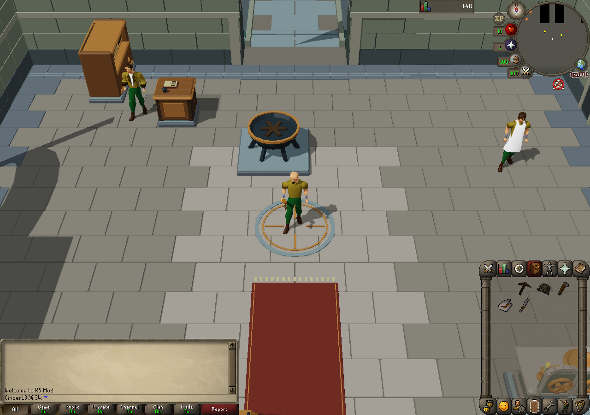

### Copper earned through ordinary mining.

Live native gameplay · Custom-art floor

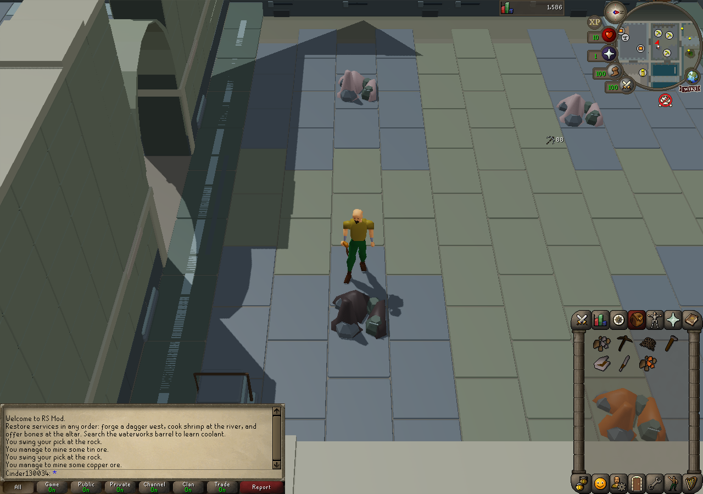

### Smelting uses the working furnace interface.

Live native gameplay · Custom-art floor

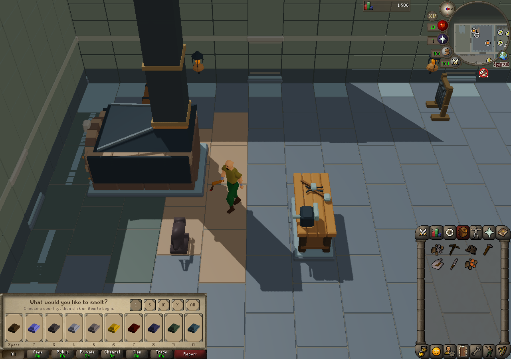

### The anvil opens the smithing choices during the preparation route.

Live native gameplay · Custom-art floor

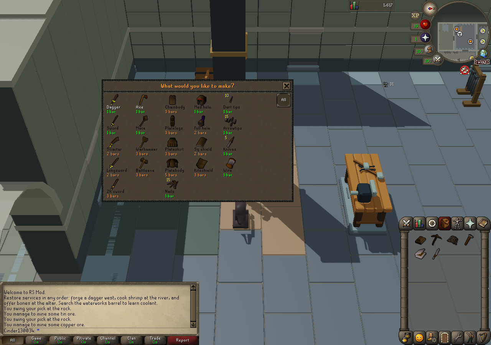

### Net fishing supplies food for preparation.

Live native gameplay · Custom-art floor

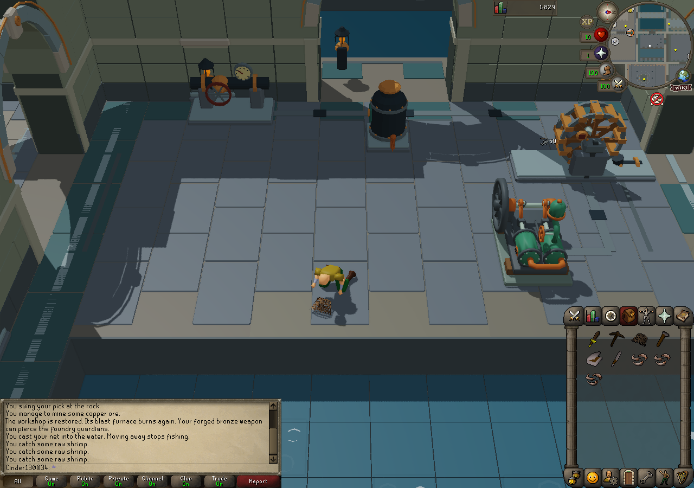

### Cooking restores the kitchen service.

Live native gameplay · Custom-art floor

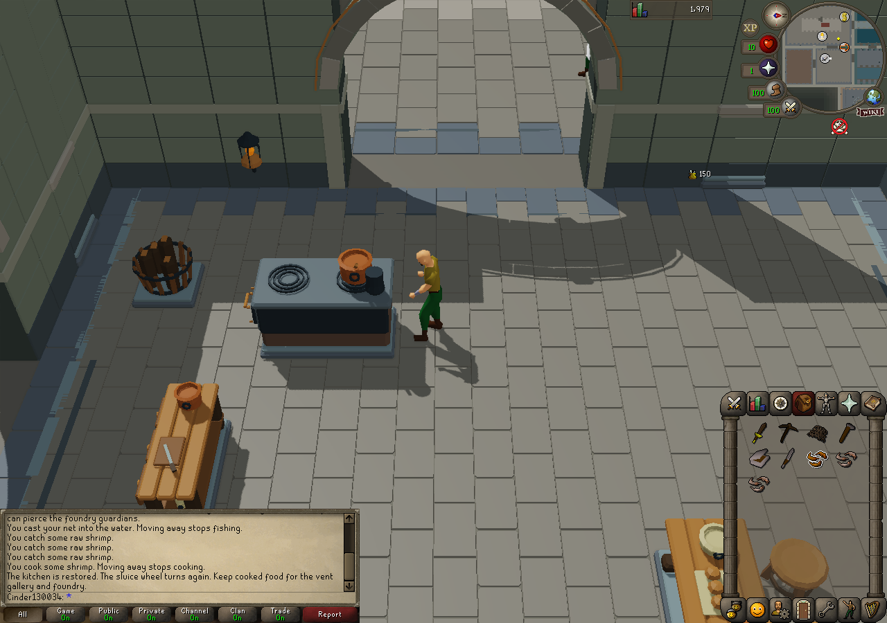

### Using earned bones restores the altar service.

Live native gameplay · Custom-art floor

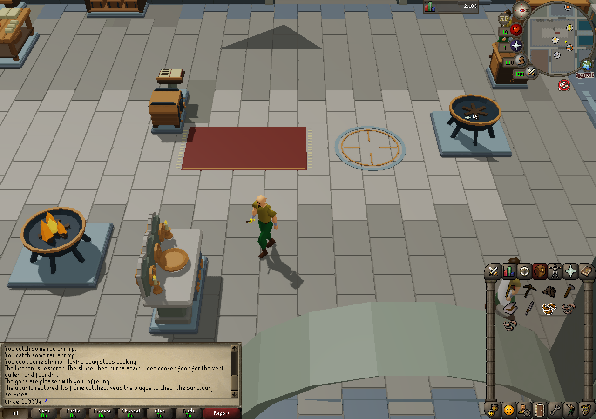

### Earlier playable floor: the journal and dormant services before preparation.

Live native gameplay · Historical earned-clear checkpoint aedd586

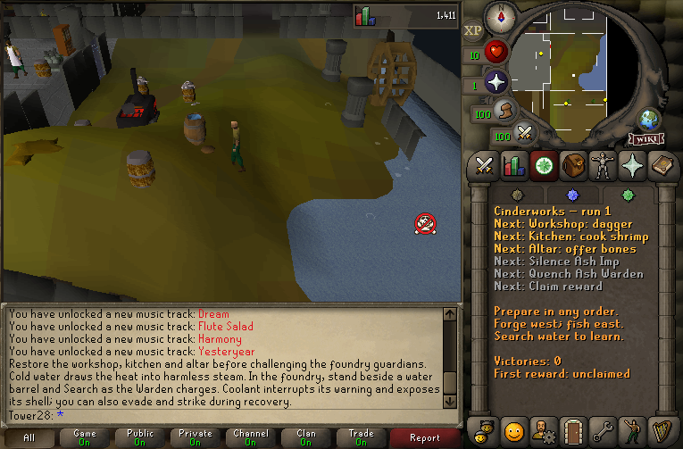

### Earlier playable floor: workshop service restored; preparation can be completed in different orders.

Live native gameplay · Historical earned-clear checkpoint aedd586

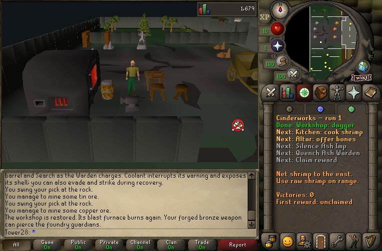

### Earlier playable floor: the Ash Imp warns with a line of smoke.

Live native gameplay · Historical earned-clear checkpoint aedd586

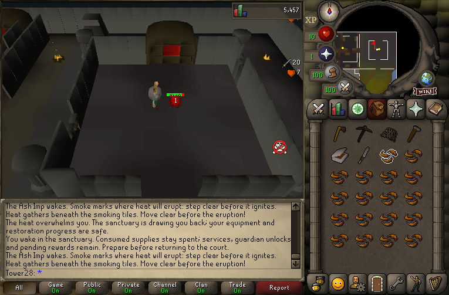

### Earlier playable floor: the Ash Warden encounter and its smoke telegraph.

Live native gameplay · Historical earned-clear checkpoint aedd586

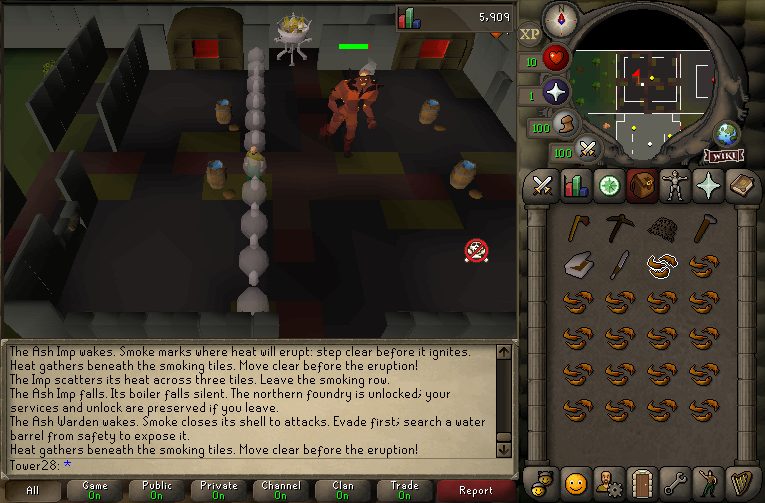

### Earlier playable floor: coolant clears the charge and exposes the Warden.

Live native gameplay · Historical earned-clear checkpoint aedd586

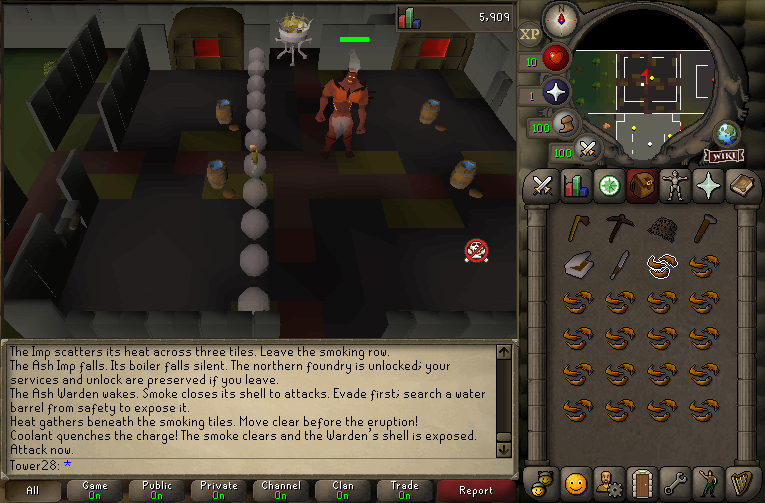

### Earlier playable floor: earned victory restores the floor and marks the reward as ready.

Live native gameplay · Historical earned-clear checkpoint aedd586

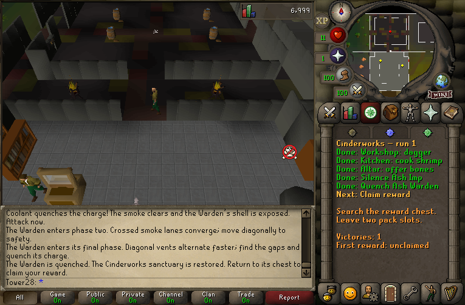

### Earlier playable floor: the reward waits while the inventory is full.

Live native gameplay · Historical earned-clear checkpoint aedd586

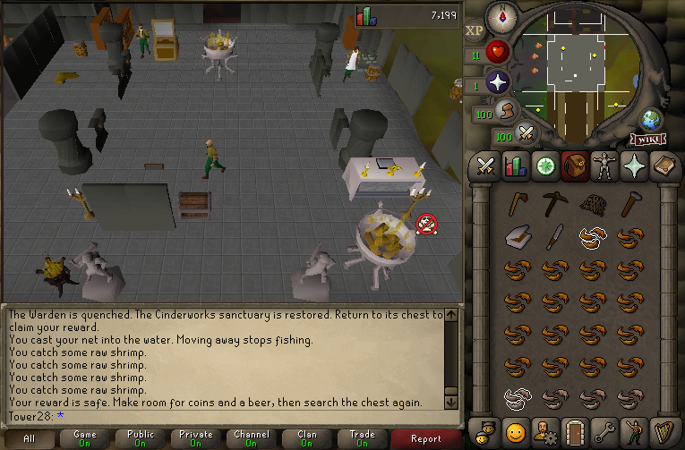

### Earlier playable floor: the settled journal after reward payment and ordinary reconnect.

Live native gameplay · Historical earned-clear checkpoint aedd586

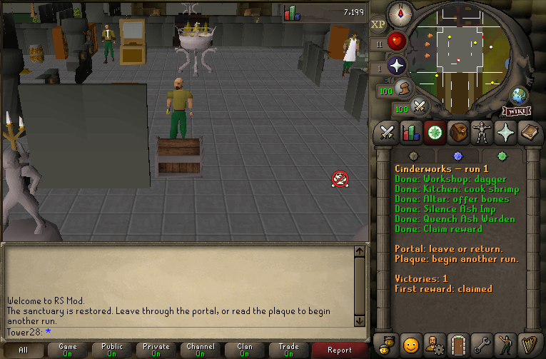

### Earlier playable floor: a real axe deposited through the bank interface.

Live native gameplay · Historical banking checkpoint 08BB264E

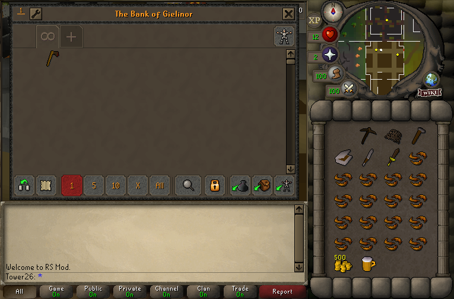

### The newer floor: sanctuary recovery after a real hazard defeat.

Live native gameplay · Custom-art floor

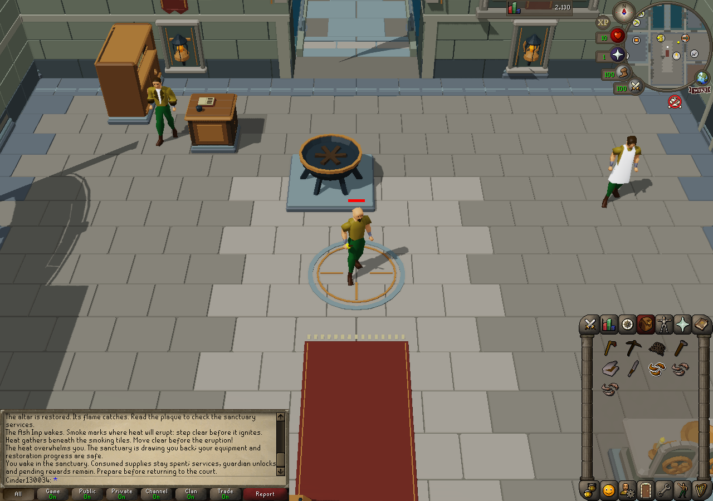

### The newer floor: a normal waterworks reconnect with the original paving and machinery present.

Live native gameplay · Final handoff client a31c18d; runtime c78e2a8

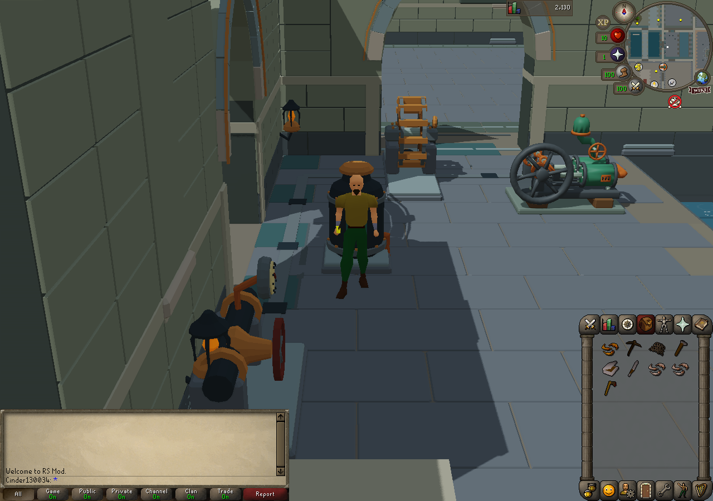

RuneScape / OSRS and authentic reference assets belong to Jagex. Unofficial development project; unaffiliated with Jagex. No source cache, extracted reference mesh or animation is distributed.
